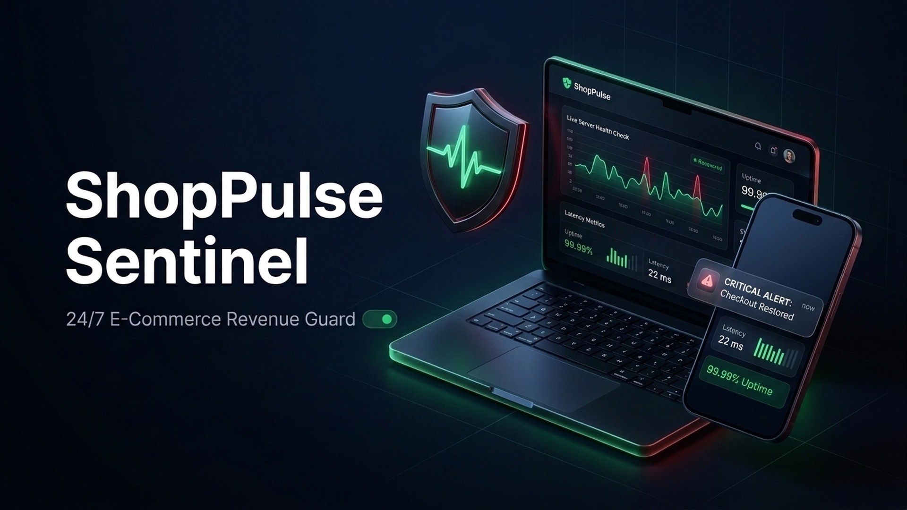

# ShopPulse Sentinel Lite 🛡️

> **Lightweight E-Commerce Checkout Healthcheck & Telegram Alert Watchdog**

An open-core monitoring utility engineered to audit critical e-commerce checkout URLs and dispatch immediate Telegram alerts when downtime or payment connectivity failures occur.



---

## ⚡ Why ShopPulse Sentinel?

Standard uptime monitors only verify if your web server returns an HTTP 200 OK status on the homepage. They fail to catch:
* Silent gateway crashes inside checkout flows.
* Third-party payment script timeouts.
* Performance degradation during peak ad campaigns.

ShopPulse Sentinel Lite audits your target checkout URL every 60 seconds and notifies your private Telegram chat or team channel the second an outage is confirmed.

---

## 🚀 Quickstart (30 Seconds)

### 1. Install Dependencies
```bash
pip install -r requirements.txt
```

### 2. Configure Environment
Copy the example environment file:
```bash
cp .env.example .env
```
Edit `.env` with your store checkout endpoint and Telegram bot credentials:
```env
CHECKOUT_URL=https://yourstore.com/checkout
CHECK_INTERVAL_SECONDS=60
TELEGRAM_BOT_TOKEN=your_bot_token
TELEGRAM_CHAT_ID=your_chat_id
```

### 3. Run the Watchdog
```bash
python sentinel_lite.py
```

---

## 📊 Feature Comparison: Lite vs PRO

| Capability | Lite (Free GitHub) | PRO Edition ($10 Lifetime) |
| :--- | :---: | :---: |
| **HTTP Status Code Audit** | ✅ 200 OK checks | ✅ Full Multi-endpoint suite |
| **Telegram Bot Alerts** | ✅ Basic Alerts | ✅ HTML Cards & Recovery Pings |
| **Silent Error Detection** | ❌ None | ✅ Keyword Assertions (Forbidden/Required) |
| **Latency Tracking** | ❌ None | ✅ Millisecond threshold alerts |
| **Catalog Stockout Watchdog** | ❌ None | ✅ Top-seller inventory tracking |
| **Price Drop Glitch Protection**| ❌ None | ✅ Anomaly detection for pricing errors |
| **Multi-Channel Connectors** | ❌ Telegram only | ✅ WhatsApp, Slack & SMTP Email |
| **Deduplication & Cooldown** | ❌ None | ✅ SQLite WAL anti-spam filters |
| **Automation Webhooks** | ❌ None | ✅ Outgoing Webhooks for n8n / Make / Sheets |
| **Production Deployment** | ❌ Local script | ✅ Docker Compose & verify_setup scripts |

---

## 🛒 Upgrade to ShopPulse Sentinel PRO

Unlock the full enterprise monitoring engine with lifetime access (zero monthly subscriptions):

* 🔴 **Get it on Whop ($10):** [whop.com/autosec/autosec-e-commerce-revenue-leak-detection](https://whop.com/autosec/autosec-e-commerce-revenue-leak-detection/)
* 🟢 **Get it on Payhip ($10):** [payhip.com/b/fZx6v](https://payhip.com/b/fZx6v)
* 🟡 **Custom Setup on Fiverr:** [fiverr.com/s/7j1PgDE](https://www.fiverr.com/s/7j1PgDE)
* 📱 **Daily Automation Releases:** [t.me/autosec_studio](https://t.me/autosec_studio)

---

Developed by **AutoSec Studio** — High-impact e-commerce automation tools.
